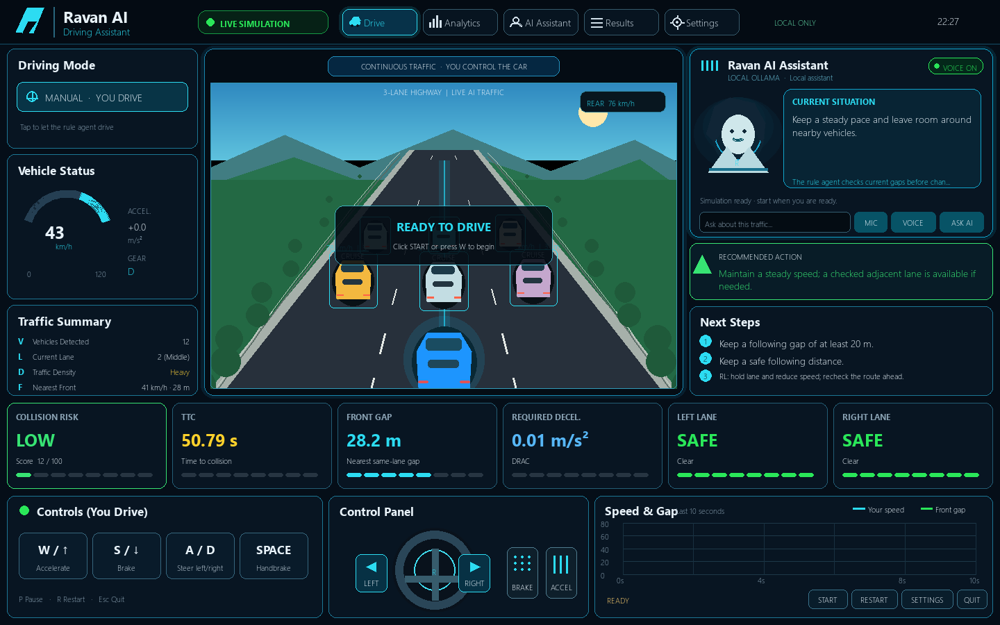
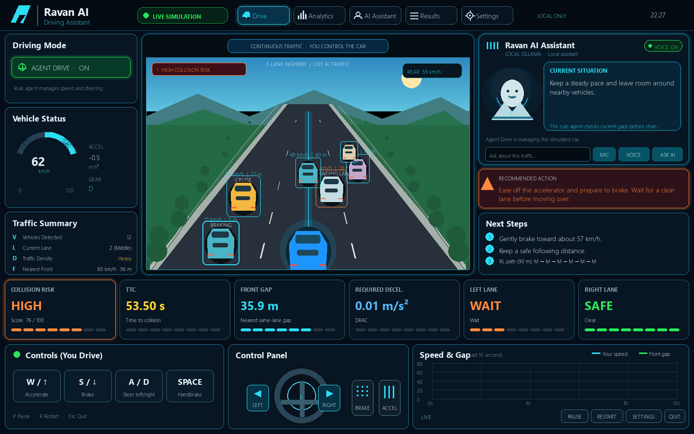

# Ravan AI Driving Assistant

Ravan AI is a local, educational driving game. It uses a dashboard-style Pygame interface over a three-lane perspective traffic simulation, computes driving-risk values in Python, and can ask a local Ollama model to explain the current simulation snapshot. It does not connect to or control a real vehicle.

## Simulation screenshots

The images below are rendered from the project’s Pygame dashboard and deterministic simulation state.

<p>
  
  
</p>

## Simulation video

[Watch the 18-second Agent Drive simulation demo with spoken assistant narration](assets/videos/ravan-ai-simulation-demo.mp4). The clip is rendered from the project's deterministic traffic simulation and Pygame dashboard. Recreate it in PowerShell with `.\scripts\render_showcase_video.ps1`; FFmpeg must be available on `PATH`, and the voice script prefers an installed en-IN voice.

## Run

From this folder in PowerShell:

```powershell
python -m pip install -r requirements-game.txt
python main.py
```

## Headless Gymnasium environment — Phase 1

The RL environment wraps the same `DrivingSimulation` and `Vehicle` physics used by the game. It does not create a second simplified traffic model, and it can run without opening a Pygame window. Install the additional dependency and validate the Gymnasium API with:

```powershell
python -m pip install -r requirements-rl.txt
python scripts/check_rl_environment.py
```

Use `src.ravan_game.rl.environment.RavanDrivingEnv` with `render_mode=None` for headless simulation, or `render_mode="human"` / `"rgb_array"` for the existing dashboard renderer. `reset(seed=...)` returns reproducible traffic for the same seed. `step(action)` uses the five-value Gymnasium API and advances the existing physics by 0.1 seconds by default (two 0.05-second simulation updates).

Discrete actions are `COAST`, `ACCELERATE`, `BRAKE`, `STEER_LEFT`, `STEER_RIGHT`, and `HANDBRAKE`. The live vehicle physics has steering rather than a separate lane-change command, so lane changes emerge from steering over time. The configurable reward in `config/rl_reward.json` records progress, collision, TTC and following-gap exposure, lane-change safety, control smoothness, braking, and road-edge components separately. Scenario families are reproducibly seeded and use the same traffic and vehicle physics as the interactive simulator. The environment does not control the interactive Pygame game.

### PPO training and held-out evaluation

Install the RL dependencies (including PyTorch if it is not already installed):

```powershell
python -m pip install -r requirements-rl.txt
```

Train PPO with training scenarios and validation-only checkpoint selection:

```powershell
python scripts/train_ppo.py --timesteps 300000 --envs 4 --seed 2026
```

Training saves checkpoints, TensorBoard logs, experiment settings, and final and best-validation models under `data/rl_runs/`. Evaluate the selected model on held-out cut-in, blind-spot, and dense-traffic families with the same seeds for PPO and the physics-rule baseline:

```powershell
python scripts/evaluate_ppo.py --model data/rl_runs/<run>/best/best_model.zip --episodes-per-scenario 10
```

The evaluator writes episode metrics, full per-step CSV trajectories, and an offline replay/results page under `data/rl_evaluations/`. It reports raw PPO, the physics-rule baseline, and PPO with a rule-based fallback. The fallback switches to the transparent rule policy after its first unsafe PPO suggestion; it is a research guard, not a guarantee. These are descriptive simulation results. PPO, the physics baseline, and the Ollama assistant are research aids; none is a certified driver-assistance system or controls a real vehicle.

Ollama should be running locally. The default model and endpoint are in `config/assistant.json`; set `RAVAN_OLLAMA_MODEL` or `RAVAN_OLLAMA_URL` to override them.

## Controls

| Input | Action |
| --- | --- |
| W or Up Arrow | Accelerate |
| S or Down Arrow | Brake |
| A/D or Left/Right Arrow | Steer and change lanes |
| Space | Emergency handbrake |
| P | Start, pause, or resume |
| R | Restart with a fresh continuous traffic stream |
| Tab | Focus the assistant question box |
| Enter | Send the typed question |
| Escape | Close the game (or leave the question box) |

The game opens paused at its actual initial vehicle speed and waits for **START**, **P**, a driving key, or an on-screen pedal/steering input. Click the **Driving Mode** control to switch between manual driving and **Agent Drive**. Agent Drive uses a local rule-based policy to manage simulated speed, braking, and lane changes; keyboard, mouse, or voice driving commands take manual control. This is an educational simulation feature, not a guarantee of safe driving. Click the left or right half of the steering wheel or its arrows to change lanes; holding an arrow keeps steering. The traffic stream has unique vehicles that follow, brake for slower traffic, change lanes when a gap is available, and periodically merge into the road. Their speeds and positions are initialized from a run seed and evolve from traffic interactions; no warning scenario is selected or triggered by a timer. The physics coach speaks immediately when a non-low risk is present and repeats a concise alert every 15 simulation seconds while it continues. It asks local Ollama for a live explanation on meaningful risk changes or a 25-second cadence while driving. Typed or spoken natural-language questions are sent to local Ollama and answered in text and voice. Assistant replies use clear Indian English; speech is slower and prefers an Indian English Windows voice when available through SAPI. The MIC is push-to-talk; after clicking it, the player can ask a question or give a short command such as “accelerate,” “brake,” “turn left,” “pause,” “resume,” or “restart.” Driving commands run as short timed inputs and are handled locally; questions stay with Ollama. It never controls a real vehicle. A short-horizon Q-learning planner recalculates an advisory lane sequence over the next 90 m about twice per second. It uses the simulated traffic positions, checks the first lane change against the physics lane-safety rule, and never steers the player. Its constant-speed traffic forecast is an educational approximation. A separate trial-and-error learner compares sustained player inputs with later physics risk scores and stores the observations in `data/learning/trial_error.json`; its summaries describe this simulation only. The dashboard has **Pause/Resume**, **Restart**, **Settings**, and **Quit** controls. Speech recognition uses faster-whisper `tiny.en` on the CPU; it may download the model files on first use. Speech output uses the installed Windows voice through pyttsx3. Both run outside the game loop. If audio hardware or a local voice is unavailable, the game continues with keyboard and text controls.

## Project layout

- `src/ravan_game/simulation.py`: continuous traffic behavior, spawning, and simulation updates
- `src/ravan_game/vehicle.py`: player and traffic vehicle movement
- `src/ravan_game/risk.py`: local speed, gap, relative motion, TTC, THW, DRAC, lane checks, and risk assessment
- `src/ravan_game/route_rl.py`: snapshot-based Q-learning for a low-cost lane sequence through predicted traffic
- `src/ravan_game/rl/`: Gymnasium actions, observations, scenarios, reward shaping, baseline policy, and headless environment wrapper
- `src/ravan_game/ai_assistant.py`: asynchronous local Ollama requests and verified fallback answers
- `src/ravan_game/learning.py`: persistent trial-and-error summaries from player actions and subsequent risk changes
- `src/ravan_game/voice.py`: push-to-talk local STT and Windows TTS workers
- `src/ravan_game/voice_commands.py`: local driving-command recognition while preserving ordinary AI questions
- `src/ravan_game/renderer.py`: game and assistant interface
- `src/ravan_game/app.py`: controls and main game loop
- `src/ravan_game/logger.py`: 5 Hz simulation telemetry CSV (no audio or chat logging)
- `scripts/evaluate_game_runs.py`: summarize a run's risk exposure and driving metrics
- `tests/`: automated unit tests
- `scripts/check_rl_environment.py`: Gymnasium environment API validation
- `scripts/train_ppo.py`: PPO training with separate validation scenarios
- `scripts/evaluate_ppo.py`: paired held-out evaluation, trajectory logging, and offline replay page

Each run writes a CSV to `data/runs/`. Review the latest run with:

```powershell
python scripts/evaluate_game_runs.py
```

To summarize a particular file, pass its path to the script.

The saved contact prediction model in `data/contact_v2/model/` is a separate research artifact trained and evaluated on synthetic toy-simulator episodes. The live game currently reports its transparent physics-based risk calculations; the saved ML model is not integrated into the live traffic loop. This is a lightweight 2D Pygame prototype, not a CARLA or SUMO simulator. Its traffic and risk calculations are for research and educational simulation, not a certified driver-assistance system.
